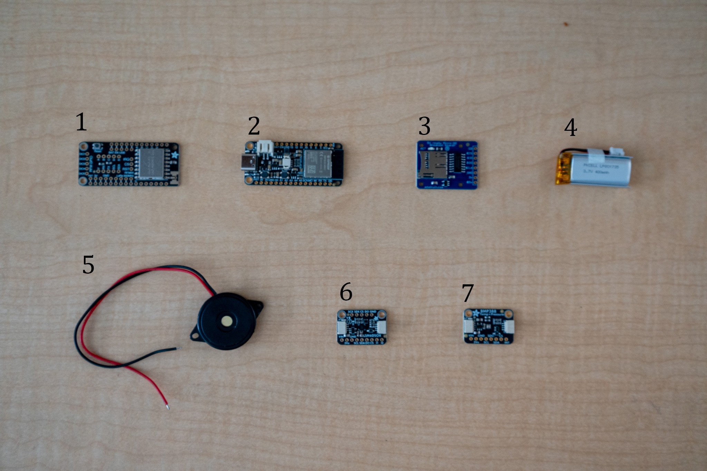

# CanSat Avionics & Telemetry System
 
A soda-can-sized flight computer that logs altitude and motion data, detects its own flight phases, and streams live telemetry to a laptop ground station over LoRa radio. It will fly as a payload in a BT-80 model rocket.
 
**Status:** In progress: bench testing (Fall 2026)
 

 
---
 
## Mission
 
Design, build, and recover a telemetry payload that logs atmospheric and inertial data and autonomously tracks its flight state from launch to touchdown.
 
**Primary objectives**
- [ ] Transmit live altitude, temperature, and battery voltage to a ground station at ≥ 1 Hz
- [ ] Detect flight states (pad → ascent → descent → landed) from live sensor data
- [ ] Log all flight data to an onboard microSD card as a backup to the radio link

**Secondary objectives**
- [ ] Auto-calibrate ground-level altitude on startup
- [ ] Record 6-axis IMU data during flight
- [ ] Sound a recovery buzzer after landing is confirmed
---
 
## Hardware
 
| # | Component | Role | Interface |
|---|---|---|---|
| 1 | RFM95W LoRa FeatherWing (915 MHz) | Telemetry radio | SPI |
| 2 | Adafruit ESP32-S3 Feather (8MB, no PSRAM) | Flight computer | — |
| 3 | MicroSD breakout | Onboard data logger | SPI |
| 4 | 400 mAh LiPo | Power | JST-PH |
| 5 | Piezo buzzer (passive) | Recovery beacon | GPIO |
| 6 | LSM6DSOX 6-DoF IMU | Acceleration, rotation rate | I2C (STEMMA QT) |
| 7 | BMP388 barometer | Altitude, temperature | I2C (STEMMA QT) |


 
The ground station is a second ESP32-S3 Feather + LoRa FeatherWing connected to a laptop over USB.
 
### Why these parts
<!-- One or two sentences each, in your own words, from the datasheets. -->
- **ESP32-S3:** Built-in wifi/bluetooth good for bench testing before adding the radio. Dual-core, allowing one core to handle sensor reading while the other handles radio transmission. Hardware floating-point unit (FPU) for fast and accurate sensor calculations. Also includes built-in LiPo battery connection and battery monitoring, along with native USB.
- **BMP388:** Tracks precise temperature and pressure with a relative accuracy of 8 pascals and &plusmn;0.5 meters of altitude, allowing for accurate flight data. Also measures temperature with &plusmn;0.5&#8451; accuracy.
- **LSM6DSOX:** 6-axis accelerometer/gyroscope capable of reading acceleration up to &plusmn;16 G, which prevents the launch data from peaking, necessary for keeping the acceleration data smooth throughout the mission.
<!-- HIDDEN UNTIL READY: remove this line and the closing arrow line below to show
- **LoRa (915 MHz):** 

### Pin map (planned)
| Signal | Feather pin |
|---|---|
| LoRa CS | 10 |
| LoRa RST | 11 |
| LoRa IRQ | 6 |
| SD CS | 5 |
| Buzzer | TBD |
| I2C sensors | STEMMA QT port |
---
## Software
Written in C++ with PlatformIO (Arduino framework).
```
firmware/          Flight computer code
ground_station/    Receiver code + Python dashboard
docs/              Build log, test reports, images
data/              Logged test and flight data
```
**Build and upload:** open `firmware/` in VS Code with the PlatformIO extension, then click Upload.
---
-->
## Test results

| # | Date | Test | Key result | Report |
|---|---|---|---|---|
| 01 | 2026-10-02 | Barometric altitude: elevator test (BMP388) | Measured ~38 m rise over 13 floors; down and up runs agree within 0.7 m. Found ~18 s filter settling lag at a 2 s sampling interval | [Test 01](docs/tests/01-elevator-altitude-test.md) |
| 02 | 2026-10-10 / 10-13 | Accelerometer 6-position calibration (LSM6DSOX) | Per-axis offset/scale correction cut worst-case error from 0.152 to 0.009 m/s² (~17×); all 6 orientations within 0.01 m/s² of 1 g; constants repeatable across 3 sessions | [Test 02](docs/tests/02-accelerometer-calibration.md) |


### Sensor characterization summary

| Sensor | Parameter | Result | Source |
|---|---|---|---|
| BMP388 | Relative altitude over a known height change | ~38 m over 13 floors (~2.9 m/floor); runs agree within 0.7 m | Test 01 |
| BMP388 | Pressure drift at rest | ~0.3 m equivalent over 10 min | Test 01 |
| BMP388 | Filter settling (IIR coeff 3, 2 s sampling) | ~18 s to within 0.1 m; ~25% of remaining gap closed per reading | Test 01 |
| LSM6DSOX | Gyro bias | Measured and removed at every startup (500-sample average) | Firmware |
| LSM6DSOX | Accelerometer offset / scale (uncorrected) | Offsets up to 0.13 m/s² (Z); scale errors +0.2 to +0.6% | Test 02 |
| LSM6DSOX | Accelerometer error after calibration | ≤ 0.009 m/s² on-axis, ≤ 0.010 m/s² magnitude, in all 6 orientations | Test 02 |
| LSM6DSOX | Calibration repeatability (3 sessions, 2 days) | Offsets within 0.025 m/s², scales within 0.1% | Test 02 |

### Planned tests
- **Static noise test:** barometric altitude and IMU noise at rest (standard deviation)
- **Test 03:** elevator test repeated with barometer + accelerometer, complete unedited logs, timestamps and startup calibration

## Build log
Progress photos and notes: [docs/build-log.md](docs/build-log.md)

 
---
 
## Roadmap
 
- [x] Component selection
- [x] Sensor bring-up (no soldering)
- [ ] Soldering + SD card logging
- [ ] LoRa radio link + ground station
- [ ] Flight state machine
- [ ] Ground tests (elevator / drop test / data replay)
- [ ] Payload sled CAD + OpenRocket simulation
- [ ] Rocket flight
